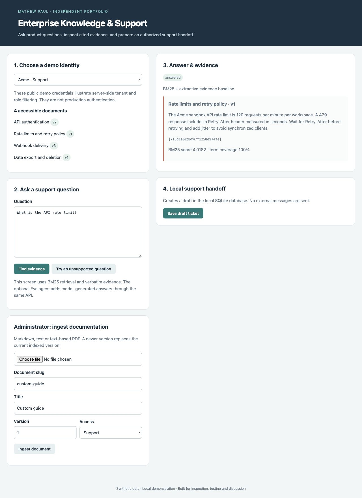

# Enterprise Knowledge & Support Agent

A support engineer needs product answers grounded in documentation they are permitted to access, plus a traceable handoff when the documentation is insufficient.

### Working features

- Markdown/text and text-based PDF ingestion, paragraph chunking, document versions and content-derived citation IDs.
- BM25 lexical retrieval with server-resolved tenant/role filtering before ranking.
- A credential-free extractive baseline that quotes evidence and abstains on weak matches.
- Idempotent local draft tickets; unavailable or unauthorized citation IDs are rejected.
- An optional Eve agent with typed retrieval and ticket tools, citations in its instructions, disabled general-purpose tools and an approval gate for saving a ticket.

**Stack:** Python, Flask, SQLite, pypdf, BM25, TypeScript, Eve, Zod, pytest.



## Setup

Requires Python 3.12+ (verified locally with 3.14.6). Run from this repository:

```sh
python3 -m venv .venv
source .venv/bin/activate
pip install -r requirements-dev.txt
pytest -q
python evaluate.py
python app.py
```

The app binds to localhost. `data/` is created on first run and excluded from Git. `DATABASE_PATH` can select a different SQLite file. Tests and evaluations use temporary databases. The Flask development server is intended for the local demo.

## Evidence and project status

This is a newly built independent portfolio implementation using synthetic data. It does not describe a customer deployment or measured business impact. See [evaluation results](docs/evaluation.json), [architecture](docs/architecture.md), [demo walkthrough](docs/demo.md) and [acceptance criteria](docs/acceptance.md). CI runs the Python tests and reproducible evaluation. Small, authored regression sets are useful checks, not generalization benchmarks.

Open **http://127.0.0.1:8102**.

## Demo

1. Run `python app.py`, then open http://127.0.0.1:8102.
2. As Acme Support, ask “What is the API rate limit?” Expect a citation to the 120 requests/minute source.
3. Save the draft ticket twice. The second action reuses the existing draft ID.
4. Try the unsupported quantum-encryption question. Expect abstention.
5. Ask “internal incident escalation code”. Support should abstain; Acme Administrator can retrieve the restricted synthetic document.
6. Switch to Beta Support and ask about the API rate limit. Expect 40 requests/minute, with no Acme evidence.
7. As Acme Administrator, ingest a Markdown document with a slug, version and role. Ingest changed content with a higher version and verify old text is no longer retrieved.

The web screen demonstrates retrieval and extractive evidence. Live model behavior requires the separate optional Eve setup and has not been verified.

## Limitations

See the explicit scope and deployment limitations in [architecture](docs/architecture.md).
