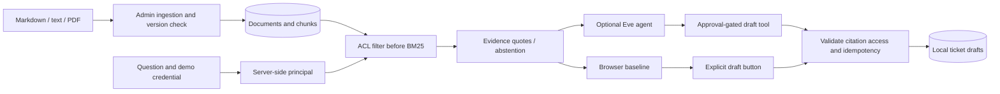

# Architecture and decisions



The Python API is the authorization boundary. Tenant and role values supplied in search requests do not change identity. A document's access roles are checked before ranking; the model cannot request another tenant. Version replacement and chunk updates occur in one transaction; stale citation IDs are rejected.

BM25 is an inspectable, low-dependency baseline. There is no embedding model, vector database, semantic reranker or production authentication in this version. Coverage thresholds can abstain on good paraphrases and answer keyword-overlap questions poorly; evaluate on larger held-out questions before making quality claims. Quotes are exact evidence but do not guarantee useful or complete answers.

The three tokens in `app.py` are public synthetic demo identities. They are not a security boundary against an attacker who knows the repository. The demo proves filtering behavior, not production identity verification. File ingestion is bounded to 1 MB / 30 PDF pages; it does not OCR scanned PDFs. Untrusted PDFs would require stronger resource isolation in production.

The Eve operator chooses `KNOWLEDGE_DEMO_TOKEN` in the environment. Tool arguments cannot override it. General-purpose default tools are disabled. Retrieved text is marked untrusted in instructions, but prompt-injection resilience of the live model has not been measured. The API's access checks remain deterministic.

## Optional model setup

The Python browser demo needs no keys. For the model-driven agent, also install Node 24:

```sh
npm ci
npm run typecheck
npm run build
# Set AI_GATEWAY_API_KEY securely in your local environment.
# Keep the Python API running on port 8102.
npm exec -- eve dev --no-ui
```

`npm run build` may fetch public model metadata. The agent uses the scaffold's `openai/gpt-6-luna-fast` model. Do not commit credentials. `.env.example` lists the settings. The TypeScript build was verified; no live model request has been made. See the installed Eve docs for session API and credential setup. A model run will incur the provider's applicable usage charges.
